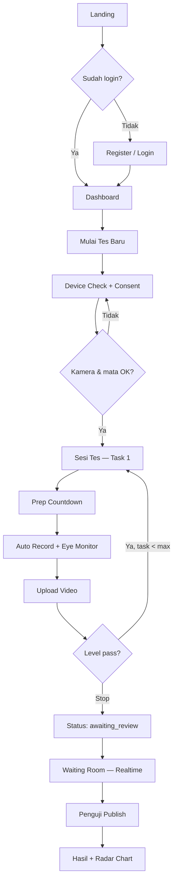
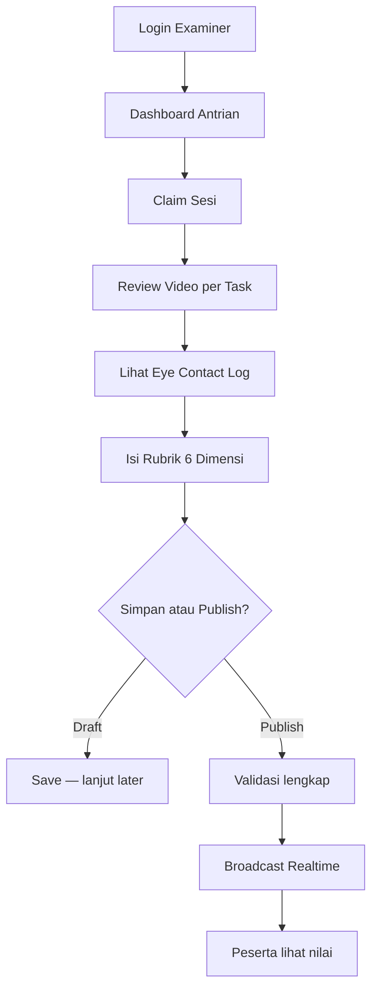
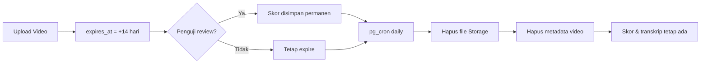
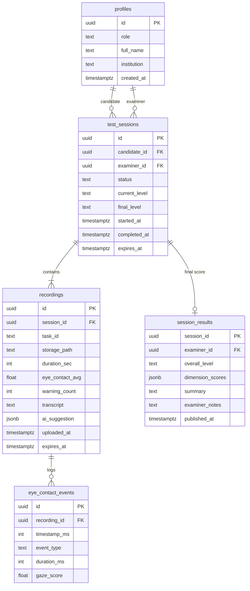

# Product Requirements Document (PRD)
# Kalam — Platform Tes Maharah Kalam (Arabic Speaking Assessment)

| Field | Value |
|---|---|
| **Versi dokumen** | 1.3 |
| **Tanggal** | 29 Juli 2026 |
| **Status** | Selaras dengan implementasi (v1 platform terbangun) |
| **Produk** | Kalam (مَهارَة الكَلام) — branded **ALIKHTIBAR** di UI |
| **Owner** | Tim Kalam |
| **Role** | candidate, examiner, **admin** |
| **Bahasa** | UI Inggris; bank soal **bilingual** (Arab & Inggris), dipilih per sesi |
| **Stack** | Next.js 16, React 19, Supabase (Auth/DB/Storage/Realtime/pg_cron), MediaPipe (browser) |

---

## Daftar Isi

1. [Ringkasan Eksekutif](#1-ringkasan-eksekutif)
2. [Latar Belakang & Masalah](#2-latar-belakang--masalah)
3. [Visi & Tujuan Produk](#3-visi--tujuan-produk)
4. [Persona Pengguna](#4-persona-pengguna)
5. [Scope Produk](#5-scope-produk)
6. [User Stories](#6-user-stories)
7. [Persyaratan Fungsional](#7-persyaratan-fungsional)
8. [Persyaratan Non-Fungsional](#8-persyaratan-non-fungsional)
9. [Alur Pengguna (User Flows)](#9-alur-pengguna-user-flows)
10. [Arsitektur Informasi & Halaman](#10-arsitektur-informasi--halaman)
11. [Model Data](#11-model-data)
12. [Integrasi & API](#12-integrasi--api)
13. [Persyaratan UI/UX](#13-persyaratan-uiux)
14. [Keamanan & Privasi](#14-keamanan--privasi)
15. [Retensi Data & Lifecycle](#15-retensi-data--lifecycle)
16. [Metrik Keberhasilan (KPI)](#16-metrik-keberhasilan-kpi)
17. [Roadmap Rilis](#17-roadmap-rilis)
18. [Risiko & Mitigasi](#18-risiko--mitigasi)
19. [Asumsi & Keputusan Terbuka](#19-asumsi--keputusan-terbuka)
20. [Lampiran](#20-lampiran)

---

## 1. Ringkasan Eksekutif

**Kalam** adalah platform web penilaian kemampuan berbicara Bahasa Arab berstandar **CEFR (Pre-A1–C2)** yang memungkinkan peserta tes melakukan ujian speaking **secara mandiri dari jarak jauh**, tanpa harus bertemu penguji secara fisik di ruangan yang sama.

Platform ini menggabungkan:

- **Autentikasi & manajemen akun** (peserta dan penguji)
- **Rekaman video + audio** dengan proctoring ringan (deteksi kontak mata)
- **Penyimpanan sementara rekaman** (±14 hari, auto-delete)
- **Dashboard penguji** untuk review video dan penilaian manusia berbasis rubrik CEFR
- **Pembaruan nilai real-time** ke peserta saat penguji menilai langsung setelah tes
- **AI assistif** (Whisper + Claude) sebagai alat bantu transkripsi dan pre-score opsional — bukan pengganti penilaian penguji

> **Catatan versi 1.3:** platform v1 sudah **terbangun**. Dokumen ini disinkronkan dengan implementasi nyata di repo. Framing lama "evolusi dari MVP stateless audio-only" sudah tidak relevan — auth, database, rekaman video, proctoring, dashboard examiner & admin, serta bilingual AR/EN sudah berjalan. Bagian yang masih menjadi pekerjaan tersisa ditandai eksplisit (mis. AI pre-score examiner belum ter-wiring; lihat §7.9 & §7.11).

---

## 2. Latar Belakang & Masalah

### 2.1 Konteks

Institusi pendidikan Bahasa Arab (pesantren, universitas, lembaga kursus) membutuhkan cara standar untuk mengukur *maharah kalam* (kemampuan berbicara). Tes speaking tradisional memerlukan:

- Penguji tersedia di waktu dan tempat yang sama dengan peserta
- Ruangan khusus dan jadwal terbatas
- Dokumentasi hasil yang konsisten antar penguji

### 2.2 Masalah yang Diselesaikan

| # | Masalah | Dampak |
|---|---|---|
| P1 | Tes speaking harus tatap muka | Kapasitas terbatas, biaya tinggi, sulit di skala |
| P2 | Tidak ada identitas peserta sebelum tes | Hasil tidak terikat akun, tidak bisa dilacak |
| P3 | Tidak ada bukti visual performa speaking | Penguji tidak bisa menilai aspek non-verbal (kontak mata, ekspresi) |
| P4 | Peserta bisa menoleh/menghindari kamera tanpa deteksi | Integritas tes rendah |
| P5 | Rekaman tidak tersimpan untuk review | Penguji tidak bisa menilai ulang atau mengecek detail |
| P6 | Penilaian AI saja tidak dipercaya institusi | Butuh penguji manusia dengan rubrik standar |
| P7 | Peserta tidak tahu nilai sampai hari berikutnya | Pengalaman tes buruk, tidak ada feedback langsung |

### 2.3 Kondisi Saat Ini (Implementasi v1)

| Aspek | Status implementasi |
|---|---|
| Auth / akun | ✅ Supabase Auth, role `candidate`/`examiner`/`admin` di `app_metadata` |
| Media | ✅ Video + audio (`MediaRecorder`), upload ke Supabase Storage |
| Storage | ✅ Bucket privat `kalam-recordings`; retensi 14 hari + auto-delete pg_cron |
| Penilaian | ✅ Penguji manusia 6 dimensi (authoritative); AI adaptif candidate 5 dimensi sebagai assist |
| Rubrik | ✅ Examiner 6 dimensi (0–5, +`interaction`); AI/candidate 5 dimensi; adaptive Pre-A1→C2, threshold ≥3.5 |
| State | ✅ Persisten di DB (`test_sessions.progress_json`), resume setelah refresh |
| Penguji | ✅ Dashboard antrian + claim + review video + rubrik + publish realtime |
| Admin | ✅ Dashboard distribusi/assign examiner + history |
| Bahasa | ✅ UI Inggris; bank soal bilingual AR/EN (`lib/cefr/tasks.ts`, `tasks-en.ts`) |
| UI | ✅ Landing, auth, dashboard peserta, tes, waiting, hasil, examiner, admin |

**Pekerjaan tersisa yang teridentifikasi:** AI pre-score untuk examiner (`recordings.ai_suggestion`) belum ter-populate; monitoring/Sentry belum ada. Retensi pg_cron & rate limiting API sudah diimplementasikan (v1.3).

---

## 3. Visi & Tujuan Produk

### 3.1 Visi

Menjadi platform tes speaking Bahasa Arab terpercaya di Indonesia — **mandiri, terstandar CEFR, dan diawasi penguji manusia** — tanpa mengharuskan peserta dan penguji berada di ruangan yang sama.

### 3.2 Tujuan (Goals)

| ID | Tujuan | Ukuran Keberhasilan |
|---|---|---|
| G1 | Peserta wajib punya akun sebelum tes | 100% sesi tes terikat `candidate_id` |
| G2 | Tes speaking mandiri via video | ≥95% sesi selesai tanpa intervensi teknis |
| G3 | Proctoring kontak mata real-time | Peringatan muncul ≤500ms setelah menoleh >2 detik |
| G4 | Auto-capture sample per task | 0 task selesai tanpa upload rekaman |
| G5 | Retensi video 14 hari | 100% file expired terhapus otomatis |
| G6 | Penguji review & nilai via dashboard | Waktu review rata-rata ≤15 menit/sesi |
| G7 | Rubrik CEFR lengkap di dashboard penguji | 6 dimensi penilaian + overall level |
| G8 | Nilai real-time ke peserta | Latency publish → tampil ≤3 detik |
| G9 | UI/UX profesional & accessible | SUS score ≥75 (post-launch survey) |

### 3.3 Non-Goals (Di Luar Scope v1)

- Sertifikasi resmi setara TOEFL/IELTS (hasil bersifat penilaian institusi)
- Tes writing/listening/reading (fokus speaking only)
- Aplikasi mobile native (web responsive saja di v1)
- Live video call antara peserta dan penguji (async review)
- Deteksi kecurangan lanjutan (face swap, multiple faces, screen recording detection)
- Multi-bahasa UI selain Indonesia + prompt Arab

---

## 4. Persona Pengguna

### 4.1 Peserta Tes (Candidate)

| Atribut | Detail |
|---|---|
| **Nama contoh** | Ahmad, mahasiswa semester 4 |
| **Usia** | 18–25 |
| **Konteks** | Ujian maharah kalam di perguruan tinggi / kursus |
| **Kebutuhan** | Tes dari kamar/kos, lihat nilai cepat, riwayat tes |
| **Pain points** | Jadwal penguji sulit, nervous di ruangan formal |
| **Literasi tech** | Menengah — familiar Zoom, Chrome |
| **Device** | Laptop dengan webcam, occasionally tablet |

### 4.2 Penguji (Examiner)

| Atribut | Detail |
|---|---|
| **Nama contoh** | Ustadz Fadhil, dosen Bahasa Arab |
| **Konteks** | Menilai 10–30 peserta per periode ujian |
| **Kebutuhan** | Antrian jelas, video + rubrik side-by-side, catatan per dimensi |
| **Pain points** | Penilaian tidak konsisten antar sesi, sulit ingat performa peserta |
| **Literasi tech** | Menengah — butuh UI sederhana, tidak teknis |

### 4.3 Admin Institusi (In Scope — v1)

| Atribut | Detail |
|---|---|
| **Peran** | Kelola penguji, distribusi/assign sesi ke penguji, lihat history |
| **Scope v1** | ✅ Diimplementasikan — dashboard `/admin/*` (`AdminDistributionClient`, `AdminExaminersClient`, `AdminHistoryClient`). Examiner tetap bisa self-claim dari antrian |
| **Role** | `admin` di `app_metadata.role`; middleware membatasi `/admin/*` |

---

## 5. Scope Produk

### 5.1 In Scope (v1.0)

```
✅ Registrasi & login (email + password)
✅ Role: candidate, examiner
✅ Pre-test device check (kamera, mic, eye tracking init)
✅ Tes adaptive CEFR (reuse logic MVP: 2 task/level, threshold ≥3.5 pada skala 0–5)
✅ Rekaman video + audio per task
✅ Eye contact detection + peringatan real-time
✅ Auto-start recording setelah countdown persiapan
✅ Upload rekaman ke cloud storage
✅ Retensi 14 hari + auto-delete
✅ Dashboard peserta (riwayat, status, nilai)
✅ Dashboard penguji (antrian, review, rubrik)
✅ Penilaian manusia 6 dimensi CEFR
✅ Realtime score publish ke peserta
✅ AI assist: transkripsi Whisper (opsional, background)
✅ Hasil akhir: radar chart, breakdown, rekomendasi, cetak/PDF
✅ Role admin: dashboard distribusi/assign penguji + history
✅ Bilingual: bank soal Arab & Inggris, dipilih per sesi
✅ Rate limiting API (AI & auth) + retensi pg_cron auto-delete
✅ Practice mode candidate (`/dashboard/practice`)
```

> **Catatan pergeseran scope v1.3:** admin panel, bilingual, dan practice mode — yang di v1.2 tercatat out-of-scope/v2 — **sudah ada di v1** dan dipindahkan ke In Scope. AI pre-score untuk penguji tetap direncanakan (§7.11) tetapi **belum ter-wiring** (kolom `ai_suggestion` belum di-populate), jadi tidak lagi ditandai ✅.

### 5.2 Out of Scope (v1.0)

```
❌ OAuth social login (Google, Apple)
❌ Pembayaran / subscription
❌ White-label multi-tenant
❌ Notifikasi email/SMS
❌ Offline mode
❌ Multi-rater (>1 penguji per sesi)
❌ AI pre-score examiner ter-wiring penuh (direncanakan, belum jalan)
```

---

## 6. User Stories

### 6.1 Peserta (Candidate)

| ID | User Story | Prioritas |
|---|---|---|
| C-01 | Sebagai peserta, saya ingin **mendaftar akun** agar hasil tes terikat identitas saya | P0 |
| C-02 | Sebagai peserta, saya ingin **login** sebelum mengakses tes | P0 |
| C-03 | Sebagai peserta, saya ingin **mengecek kamera dan mic** sebelum tes dimulai | P0 |
| C-04 | Sebagai peserta, saya ingin **melihat preview kamera** selama tes berlangsung | P0 |
| C-05 | Sebagai peserta, saya ingin **diberi peringatan** jika pandangan saya tidak fokus ke kamera | P0 |
| C-06 | Sebagai peserta, saya ingin **rekaman dimulai otomatis** setelah waktu persiapan habis | P0 |
| C-07 | Sebagai peserta, saya ingin **menyelesaikan tes mandiri** tanpa bertemu penguji | P0 |
| C-08 | Sebagai peserta, saya ingin **menunggu penilaian** dengan status yang jelas | P1 |
| C-09 | Sebagai peserta, saya ingin **melihat nilai secara real-time** saat penguji menilai | P0 |
| C-10 | Sebagai peserta, saya ingin **melihat riwayat tes** dan unduh sertifikat/hasil | P1 |
| C-11 | Sebagai peserta, saya ingin **tahu kapan rekaman saya dihapus** (transparansi retensi) | P2 |

### 6.2 Penguji (Examiner)

| ID | User Story | Prioritas |
|---|---|---|
| E-01 | Sebagai penguji, saya ingin **login dengan akun examiner** | P0 |
| E-02 | Sebagai penguji, saya ingin **melihat antrian sesi** yang menunggu review | P0 |
| E-03 | Sebagai penguji, saya ingin **memutar rekaman video** per task peserta | P0 |
| E-04 | Sebagai penguji, saya ingin **melihat log kontak mata** (kapan peserta menoleh) | P1 |
| E-05 | Sebagai penguji, saya ingin **menilai setiap dimensi CEFR** dengan descriptor panduan | P0 |
| E-06 | Sebagai penguji, saya ingin **menulis catatan** per dimensi dan overall | P1 |
| E-07 | Sebagai penguji, saya ingin **melihat transkripsi AI** sebagai referensi (bukan keputusan final) | P1 |
| E-08 | Sebagai penguji, saya ingin **publish nilai** sehingga peserta langsung melihat | P0 |
| E-09 | Sebagai penguji, saya ingin **melihat pre-score AI** sebagai saran awal | P2 |
| E-10 | Sebagai penguji, saya ingin **claim sesi** dari antrian agar tidak bentrok dengan penguji lain | P1 |

### 6.3 Sistem

| ID | User Story | Prioritas |
|---|---|---|
| S-01 | Sistem harus **menyimpan rekaman video** maksimal 14 hari | P0 |
| S-02 | Sistem harus **menghapus otomatis** rekaman dan metadata expired | P0 |
| S-03 | Sistem harus **mencegah akses tes** tanpa login | P0 |
| S-04 | Sistem harus **membatasi akses examiner routes** ke role examiner | P0 |
| S-05 | Sistem harus **broadcast score update** via Realtime ke peserta | P0 |

---

## 7. Persyaratan Fungsional

### 7.1 Autentikasi & Manajemen Akun

#### FR-AUTH-01: Registrasi Peserta
- Form: nama lengkap, email, password (min 8 karakter)
- Verifikasi email wajib sebelum tes pertama
- Role default: `candidate`
- Redirect ke `/dashboard` setelah verifikasi

#### FR-AUTH-02: Registrasi Penguji
- Hanya via **invite link** atau **admin seed** (v1: manual insert ke DB)
- Role: `examiner` disimpan di `app_metadata` (bukan `user_metadata`)
- Field tambahan: institusi (opsional)

#### FR-AUTH-03: Login
- Email + password
- Session JWT via Supabase Auth
- Remember me (persistent session 30 hari)

#### FR-AUTH-04: Middleware Proteksi Route
| Route | Akses |
|---|---|
| `/`, `/login`, `/register` | Public |
| `/dashboard`, `/tes/*`, `/hasil/*` | Auth required (candidate) |
| `/examiner/*` | Auth + role `examiner` |

#### FR-AUTH-05: Profil
- Edit nama, ganti password
- Lihat email (read-only)

---

### 7.2 Pre-Test Setup (Device Check)

#### FR-SETUP-01: Permission Check
- Request `getUserMedia({ video: true, audio: true })`
- Tampilkan error actionable jika ditolak:
  - "Izinkan akses kamera di pengaturan browser"
  - Link bantuan per browser (Chrome, Firefox, Safari)

#### FR-SETUP-02: Preview Kamera
- Live preview 640×480 minimum
- Indikator: kamera ✓, mic ✓, eye tracker ✓

#### FR-SETUP-03: Eye Tracker Calibration
- Inisialisasi MediaPipe Face Landmarker
- Warmup 3 detik — deteksi wajah terlihat
- Jika wajah tidak terdeteksi >5 detik: blokir lanjut, minta posisi ulang

#### FR-SETUP-04: Consent
- Checkbox: "Saya setuju rekaman video disimpan sementara (14 hari) untuk penilaian penguji"
- Wajib dicentang sebelum "Mulai Tes"

---

### 7.3 Sesi Tes (Test Session)

#### FR-TEST-01: Pembuatan Sesi
- Saat peserta klik "Mulai Tes", buat record `test_sessions`:
  - `candidate_id`, `status: in_progress`, `current_level: A1`
  - `started_at`, `expires_at` (+14 hari dari selesai)

#### FR-TEST-02: Adaptive Level Logic (Reuse MVP)
- 2 task per level CEFR
- Pass threshold: rata-rata overall **≥ 3.5** (skala 0–5) — untuk **progression otomatis level**
- Catatan: progression level ditentukan **sistem** (pre-score AI opsional); **nilai final** dari penguji
- Level: A1 → A2 → B1 → B2 → C1 → C2
- Stop jika gagal level; `final_level` = level tertinggi lulus

#### FR-TEST-03: Format Soal (5 format)
| Format | Label ID | Durasi rekam | Prep |
|---|---|---|---|
| `muqaddimah` | Perkenalan diri | 60s | 15s |
| `wasf` | Deskripsi gambar | 90s | 30s |
| `hiwar` | Roleplay/dialog | 90s | 30s |
| `munaqasyah` | Pendapat/argumentasi | 90s | 30s |
| `custom` | Topik bebas | 60s | 15s |

#### FR-TEST-04: Task Flow per Soal
```
[Loading task]
    → [Preparation countdown] (timer visible, kamera preview aktif)
    → [Recording auto-start] (timer rekam, eye monitor aktif)
    → [Recording auto-stop] (saat durasi habis)
    → [Uploading] (progress bar)
    → [Uploaded ✓] (lanjut ke task berikutnya atau selesai)
```

#### FR-TEST-05: State Persistence
- Progress sesi disimpan di DB — refresh browser tidak kehilangan progress
- Resume dari task terakhir jika `status: in_progress`

#### FR-TEST-06: Penyelesaian Sesi
- Setelah task terakhir: `status: awaiting_review`
- Assign ke antrian penguji (unclaimed)
- Redirect peserta ke `/tes/[sessionId]/waiting`

---

### 7.4 Rekaman Video & Audio

#### FR-REC-01: Recording Spec
- Container: WebM (VP8/VP9 + Opus)
- Resolusi minimum: 640×480 @ 24fps
- Bitrate target: 500–1000 kbps (configurable)
- Fallback MIME: `video/webm;codecs=vp8,opus` → `video/webm` → error

#### FR-REC-02: Auto-Capture
- Recording dimulai otomatis saat countdown prep = 0
- Tidak ada tombol manual start/stop (kecuali emergency stop = batalkan task)
- Satu blob per task, upload segera setelah stop

#### FR-REC-03: Upload
- Upload ke Supabase Storage: `recordings/{session_id}/{task_id}.webm`
- Signed URL untuk playback (examiner & candidate owner)
- Metadata di DB: `duration_sec`, `file_size_bytes`, `storage_path`, `uploaded_at`

#### FR-REC-04: Retry Upload
- Jika upload gagal: retry 3× dengan exponential backoff
- Jika tetap gagal: tampilkan error + tombol "Coba Upload Lagi"
- Task tidak dianggap selesai sampai upload sukses

---

### 7.5 Eye Contact Detection (Proctoring)

#### FR-EYE-01: Teknologi
- **MediaPipe Face Landmarker** (browser-side, WASM)
- Tidak mengirim frame video ke server untuk deteksi (privasi + latency)

#### FR-EYE-02: Algoritma Gaze Score
- Input: landmark mata kiri, mata kanan, iris
- Output: `gaze_score` 0.0–1.0 (1.0 = fokus ke kamera)
- Threshold:
  - ≥ 0.6 → **Hijau** — "Kontak mata baik"
  - 0.4–0.6 → **Kuning** — "Sedikit menoleh"
  - < 0.4 selama >2 detik → **Merah** — peringatan

#### FR-EYE-03: Peringatan UI
- Overlay toast non-blocking di atas preview kamera
- Suara opsional (beep ringan) — default off
- Counter: "Peringatan ke-N" (max 3 per task sebelum flag ke penguji)

#### FR-EYE-04: Event Logging
- Simpan ke `eye_contact_events`:
  - `recording_id`, `timestamp_ms`, `event_type` (`warning` | `looked_away` | `face_lost`)
  - `duration_ms`, `gaze_score`
- Agregat per recording: `eye_contact_avg`, `warning_count`

#### FR-EYE-05: Batasan & Disclaimer
- Eye contact **bukan** penilaian otomatis final — hanya data proctoring
- Penguji melihat log; dimensi "Interaction/Eye Contact" dinilai manusia

---

### 7.6 Penyimpanan & Retensi

#### FR-STORE-01: Retensi
- Semua rekaman video: **14 hari** sejak `uploaded_at`
- `expires_at = uploaded_at + interval '14 days'`

#### FR-STORE-02: Auto-Delete ✅ (v1.3)
- Diimplementasikan: migration `20250622000000_recording_retention_cleanup.sql` — fungsi `kalam_delete_expired_recordings()` (SECURITY DEFINER) dijadwalkan `pg_cron` harian 02:00 UTC (idempotent; guarded jika pg_cron tak tersedia).
- Job harian:
  1. Snapshot recordings WHERE `expires_at < now()` ke `deletion_audit_log`
  2. Hapus objek dari bucket `kalam-recordings` (`storage.objects`)
  3. Hapus baris `recordings` (→ `eye_contact_events` cascade)
  4. Flip sesi belum-dinilai ke `expired` (sesi ber-`session_results` tak disentuh)
  5. Prune `deletion_audit_log` > 90 hari
- Uji manual: `select public.kalam_delete_expired_recordings();`

#### FR-STORE-03: Transparansi ke Peserta
- Dashboard menampilkan: "Rekaman dihapus otomatis pada [tanggal]"
- Setelah delete: status "Rekaman expired" — metadata skor tetap ada

#### FR-STORE-04: Metadata Persisten
- Skor penguji, transkripsi, summary: **tidak dihapus** (hanya video)
- Retensi metadata skor: permanen (v1)

---

### 7.7 Dashboard Peserta

#### FR-DASH-C-01: Overview
- Daftar sesi tes: tanggal, status, level, nilai (jika ada)
- Status badge:
  - `in_progress` — Sedang berlangsung (lanjutkan)
  - `awaiting_review` — Menunggu penguji
  - `under_review` — Sedang dinilai
  - `completed` — Selesai (lihat hasil)
  - `expired` — Rekaman sudah dihapus

#### FR-DASH-C-02: Waiting Room (Realtime)
- Halaman `/tes/[sessionId]/waiting`
- Polling/Realtime subscribe ke `session_results`
- Saat penguji publish: redirect otomatis ke `/hasil/[sessionId]`
- Fallback: tombol "Refresh" jika Realtime disconnect

#### FR-DASH-C-03: Hasil Tes
- Reuse komponen MVP: radar chart 6 dimensi, breakdown, rekomendasi
- Tambahan: catatan penguji per dimensi
- Tombol cetak/PDF
- Overall CEFR level dari penguji (authoritative)

---

### 7.8 Dashboard Penguji

#### FR-DASH-E-01: Antrian Sesi
- Tabel: nama peserta, tanggal tes, jumlah task, status, eye warning count
- Filter: pending / claimed / completed
- Sort: oldest first (FIFO)
- Tombol "Claim" → assign `examiner_id` ke sesi

#### FR-DASH-E-02: Review Session
Layout split 60/40:

**Kiri (60%):**
- Video player per task (tab/task selector)
- Timeline markers untuk eye contact events
- Transkripsi AI (jika tersedia) di bawah player

**Kanan (40%):**
- Form rubrik 6 dimensi (lihat §7.9)
- Catatan per dimensi (textarea)
- Overall CEFR level dropdown
- Summary feedback (textarea)
- Tombol "Simpan Draft" | "Publish Nilai"

#### FR-DASH-E-03: Publish Nilai
- Validasi: semua 6 dimensi harus diisi (0–5, bilangan bulat)
- Overall level wajib
- Saat publish:
  - `session_results` upsert
  - `test_sessions.status` → `completed`
  - Realtime broadcast ke peserta
  - Timestamp `published_at`

#### FR-DASH-E-04: Draft Save
- Penguji bisa save partial dan lanjut later
- Draft tidak visible ke peserta

---

### 7.9 Rubrik Penilaian CEFR (Penguji)

> **Dua rubrik berbeda (implementasi):**
> - **Examiner (authoritative):** **6 dimensi** termasuk `interaction` — `lib/examiner/rubric.ts`.
> - **AI adaptif candidate (assist, progression):** **5 dimensi** tanpa `interaction` — `lib/cefr/rubric.ts`. `interaction` (turn-taking, kontak mata) sengaja **tidak** dinilai AI karena tak dapat dijustifikasi dari transkrip saja (analog dengan pronunciation), dan merupakan penilaian manusia.

#### FR-RUBRIC-01: Dimensi Penilaian (6 dimensi, skala 0–5)

Skala **0–5** (bilangan bulat per dimensi) dipilih agar selaras dengan praktik penilaian CEFR yang umum di institusi pendidikan dan memberi granularitas lebih baik dibanding skala 0–4 MVP.

| # | Key | Nama ID | Nama AR | Sumber |
|---|---|---|---|---|
| 1 | `pronunciation` | Pelafalan | النُطْق | Adapt dari MVP |
| 2 | `fluency` | Kefasihan | الطَلاقَة | Adapt dari MVP |
| 3 | `grammar` | Tata Bahasa | القَواعِد | Adapt dari MVP |
| 4 | `vocabulary` | Kosakata | المُفْرَدات | Adapt dari MVP |
| 5 | `coherence` | Koherensi | التَماسُك | Adapt dari MVP |
| 6 | `interaction` | Interaksi | التَفاعُل | **Baru** — responsiveness, turn-taking, eye contact |

**Konvensi input UI:** tombol radio atau segmented control `[0][1][2][3][4][5]` per dimensi; tooltip menampilkan descriptor band saat hover.

#### FR-RUBRIC-02: Score Bands (per dimensi, skala 0–5)

| Skor | Label | Deskripsi |
|---|---|---|
| 0 | Tidak dinilai / Tidak ada bukti | Tidak ada output, diam, atau tidak comprehensible sama sekali |
| 1 | Sangat di bawah harapan | Fragment ekstrem, hampir tidak komunikatif, error mayor di semua aspek |
| 2 | Di bawah harapan | Pesan sangat terbatas tersampaikan; error signifikan menghambat pemahaman |
| 3 | Sesuai harapan (Cukup) | Pesan dasar tersampaikan untuk level target; error noticeable tapi tidak fatal |
| 4 | Di atas harapan (Baik) | Komunikatif dan natural dengan error minor; performa solid untuk level |
| 5 | Sangat di atas harapan (Unggul) | Hampir/seperti penutur asli; akurat, natural, nuansa halus |

**Threshold lulus level (progression):** rata-rata overall per dimensi **≥ 3.5** pada 2 task di level yang sama.

#### FR-RUBRIC-02b: Score Bands Agregat (rata-rata overall)

Digunakan untuk label warna di hasil peserta, radar chart, dan ringkasan sesi:

| Rentang rata-rata | Label | Warna (hex) |
|---|---|---|
| 0 – 1.5 | Belum Memadai | `#dc2626` |
| 1.5 – 2.5 | Berkembang | `#f97316` |
| 2.5 – 3.0 | Mendekati Cukup | `#eab308` |
| 3.0 – 3.5 | Memadai | `#84cc16` |
| 3.5 – 4.5 | Baik | `#22c55e` |
| 4.5 – 5.0 | Sangat Baik | `#0ea5e9` |

#### FR-RUBRIC-03: Descriptor per Level
- Setiap dimensi menampilkan collapsible descriptor Pre-A1–C2 (dari `LEVEL_DESCRIPTORS` + per-dimension guide)
- Penguji klik level referensi sebagai panduan, bukan auto-fill

#### FR-RUBRIC-04: Overall CEFR Level
- Dropdown: Pre-A1, A1, A2, B1, B2, C1, C2
- **Keputusan penguji** — bukan rata-rata otomatis dimensi
- Tooltip: "Tentukan level holistik berdasarkan seluruh performa"

#### FR-RUBRIC-05: AI Pre-Score untuk Penguji (Opsional — **belum ter-wiring**)
- **Status v1.3:** kolom `recordings.ai_suggestion` (jsonb) ada, tetapi **belum di-populate** oleh kode mana pun. Form penguji sudah membaca `aiSuggestion` secara defensif (skalar overall di sebelah tiap dimensi) — saat ini selalu `null`.
- Rencana: background job Whisper → Claude → suggestion scores, disimpan ke `recordings.ai_suggestion`
- Ditampilkan sebagai "Saran AI" (greyed out) di form penguji; penguji accept/adjust — AI tidak auto-publish
- Catatan: alur AI candidate saat ini (`/api/assess`, 5 dimensi) berbeda tujuan — untuk progression & radar AI-only peserta, bukan pre-score examiner
- Jika pre-score examiner diaktifkan, prompt Claude wajib menyebut skala 0–5 dan descriptor band FR-RUBRIC-02

---

### 7.10 Realtime Score Updates

#### FR-RT-01: Mekanisme
- Supabase Realtime: channel `session:{session_id}`
- Event: `score_published`
- Payload: `dimension_scores`, `overall_level`, `summary`, `examiner_notes`

#### FR-RT-02: Client Peserta
- Subscribe saat masuk waiting room
- On event: animate score cards masuk, tampilkan radar chart
- Latency target: ≤3 detik dari klik publish penguji

#### FR-RT-03: Client Penguji
- Confirmation toast: "Nilai berhasil dikirim ke [nama peserta]"

---

### 7.11 AI Assistif (Background)

#### FR-AI-01: Transkripsi
- Trigger setelah upload video selesai
- Extract audio → Whisper (`whisper-1`, language=`ar`)
- Simpan `transcript` di `recordings`
- Tidak blocking — penguji bisa review sebelum transkrip selesai

#### FR-AI-02: Pre-Score
- Trigger setelah transkrip tersedia
- Claude Sonnet 4.6 + rubrik prompt (reuse `lib/cefr/prompt.ts`)
- Simpan di `recordings.ai_suggestion` (JSON)
- Label jelas: "Saran AI — bukan nilai final"

---

## 8. Persyaratan Non-Fungsional

### 8.1 Performance

| Metrik | Target |
|---|---|
| First Contentful Paint | ≤1.5s |
| Eye contact frame processing | ≥15 fps |
| Video upload (50MB) | ≤30s on 10Mbps |
| Realtime score latency | ≤3s |
| API response (non-AI) | ≤500ms p95 |

### 8.2 Availability

- Uptime target: 99.5% (Supabase + Vercel)
- Graceful degradation: jika eye tracker gagal load, tes tetap bisa lanjut dengan warning

### 8.3 Compatibility

| Browser | Minimum Version |
|---|---|
| Chrome | 90+ |
| Edge | 90+ |
| Firefox | 88+ |
| Safari | 15+ (desktop) |

- WebRTC / MediaRecorder wajib
- WASM support wajib (MediaPipe)

### 8.4 Accessibility

- WCAG 2.1 AA untuk halaman non-test (login, dashboard, hasil)
- Halaman tes: exemption partial (video required by design)
- Keyboard navigation di form rubrik penguji
- Kontras warna minimum 4.5:1

### 8.5 Scalability

- Target v1: 500 sesi/bulan, 50 concurrent
- Storage: ~50MB × 500 = ~25GB/bulan (rolling 14 hari ≈ 12GB active)

### 8.6 Localization

- UI: **Bahasa Inggris** (implementasi saat ini)
- Bank soal: **bilingual** — Arab (RTL, font Amiri) & Inggris, dipilih per sesi (`test_sessions.language`)
- Rubrik descriptor: Inggris (+ nama dimensi AR)

---

## 9. Alur Pengguna (User Flows)

### 9.1 Flow Peserta — Tes Lengkap



### 9.2 Flow Penguji — Review & Nilai



### 9.3 Flow Retensi Data



---

## 10. Arsitektur Informasi & Halaman

### 10.1 Sitemap

Sitemap aktual (implementasi):

```
/                           Landing (public)
/login                      Login (demo logins tersedia)
/register                   Registrasi peserta
/forgot-password            Reset password
/auth/callback              Email verification callback

/dashboard                  Home peserta — ringkasan
/dashboard/tests            Riwayat sesi tes
/dashboard/practice         Practice hub
/dashboard/profile          Edit profil

/tes                        Test orchestrator (device check + consent inline; ?session= resume, ?lang=)
/tes/[sessionId]/waiting    Waiting room (realtime)
/hasil                      Hasil + radar + PDF (?session=)

/examiner                   Dashboard penguji — antrian
/examiner/sessions/[id]     Review + rubrik form
/examiner/history           Sesi yang sudah dinilai

/admin                      Dashboard admin — distribusi
/admin/examiners            Kelola penguji
/admin/history              Riwayat sesi (admin)

/api/sessions/*             CRUD sesi tes
/api/recordings/*           Upload, signed playback URLs
/api/examiner/*             Queue, claim, scores, publish
/api/admin/*                Assign/distribusi examiner
/api/transcribe             Whisper (AI assist)
/api/assess, /api/finalize  Claude scoring (AI assist)
/api/auth/*                 Register/login/logout/reset
```

> Catatan: device check + consent (FR-SETUP) tergabung inline di `TestIntroScreen` pada `/tes`, bukan route `/tes/setup` terpisah. Hasil & tes memakai query param `?session=`, bukan segmen `[sessionId]`.

### 10.2 Navigasi

**Peserta:** Logo → Dashboard | Profil | Logout

**Penguji:** Logo → Antrian | Riwayat | Logout

---

## 11. Model Data

### 11.1 Entity Relationship



### 11.2 Status State Machine — `test_sessions`

```
in_progress → awaiting_review → under_review → completed
                     ↓
                  expired (video deleted, scores may exist)
```

| Status | Trigger |
|---|---|
| `in_progress` | Sesi dibuat, tes berlangsung |
| `awaiting_review` | Peserta selesai semua task |
| `under_review` | Penguji claim sesi |
| `completed` | Penguji publish nilai |
| `expired` | Video deleted, no score published |

---

## 12. Integrasi & API

### 12.1 Supabase Services

| Service | Penggunaan |
|---|---|
| Auth | Login, JWT, role di app_metadata |
| PostgreSQL | Semua metadata, skor, events |
| Storage | Bucket `recordings` (private) |
| Realtime | Score publish broadcast |
| pg_cron | Daily cleanup job |
| Edge Functions (opsional) | Transcribe trigger webhook |

### 12.2 External APIs

| API | Penggunaan | Wajib? |
|---|---|---|
| OpenAI Whisper | Transkripsi Arab | Opsional (assist) |
| Anthropic Claude | Pre-score suggestion | Opsional (assist) |
| MediaPipe (CDN) | Face Landmarker WASM | Wajib (client-side) |

### 12.3 API Routes (Next.js)

| Method | Endpoint | Deskripsi |
|---|---|---|
| POST | `/api/sessions` | Buat sesi baru |
| GET | `/api/sessions/[id]` | Detail sesi + recordings |
| PATCH | `/api/sessions/[id]` | Update status/level |
| POST | `/api/recordings/upload-url` | Signed upload URL |
| POST | `/api/recordings/[id]/events` | Batch eye contact events |
| GET | `/api/recordings/[id]/playback-url` | Signed playback URL |
| POST | `/api/scores/[sessionId]` | Save draft scores |
| POST | `/api/scores/[sessionId]/publish` | Publish + Realtime |
| POST | `/api/transcribe` | Whisper (existing) |
| POST | `/api/assess` | Claude pre-score (existing) |

---

## 13. Persyaratan UI/UX

### 13.1 Design Principles

1. **Calm & focused** — halaman tes minim distraksi, dominan soal + kamera
2. **Trustworthy** — transparansi retensi data, consent jelas
3. **Bilingual elegance** — Indonesia untuk UI, Arab RTL untuk soal
4. **Progressive disclosure** — rubrik penguji: expand descriptor on demand
5. **Realtime delight** — animasi halus saat nilai masuk

### 13.2 Design System (Reuse + Extend)

- **Colors:** palette `kalam-*` (existing Tailwind config)
- **Fonts:** Inter (UI), Amiri (Arabic prompts)
- **Components:** extend existing `TaskCard`, `LevelProgress`, `ResultPanel`, `RadarChartClient`

### 13.3 Halaman Kunci — Wireframe Deskriptif

#### Landing (revised)
- Hero: "Tes Maharah Kalam — dari mana saja, dinilai penguji berpengalaman"
- CTA: "Daftar" / "Login" (bukan "Mulai tanpa registrasi")
- 3 value props: Standar CEFR | Tes mandiri video | Penilaian penguji manusia
- Flow diagram 4 langkah

#### Test Page — Split Layout
```
┌─────────────────────────────────────────────────────────┐
│  [A1 ●──○ A2 ○──○ B1 ...]          Level Progress       │
├──────────────────────────┬──────────────────────────────┤
│                          │  ┌──────────────────────┐    │
│  SOAL (Arabic RTL)       │  │   Camera Preview     │    │
│  ─────────────           │  │   🟢 Kontak mata baik │    │
│  Deskripsi (ID)          │  └──────────────────────┘    │
│                          │  Prep: 0:15  │  Rekam: —     │
│  [Gambar wasf jika ada]  │  ⚠ Peringatan (if any)       │
│                          │                              │
└──────────────────────────┴──────────────────────────────┘
```

#### Examiner Review
```
┌──────────────────────────┬──────────────────────────────┐
│  [Task 1] [Task 2] ...   │  RUBRIK CEFR                 │
│  ┌────────────────────┐  │  Pelafalan  [0][1][2][3][4][5]│
│  │                    │  │  ▼ Descriptor B1             │
│  │    Video Player    │  │  Catatan: ___________        │
│  │    ───●─── 1:23    │  │  ...                         │
│  └────────────────────┘  │  Overall: [B1 ▼]             │
│  Transkripsi: ...        │  [Simpan Draft] [Publish]    │
└──────────────────────────┴──────────────────────────────┘
```

#### Waiting Room
- Ilustrasi tenang + "Penguji sedang menilai jawaban Anda"
- Progress indicator animasi
- Estimasi: "Biasanya 5–15 menit"
- Realtime connection status dot

### 13.4 Responsive Breakpoints

| Breakpoint | Test Layout |
|---|---|
| ≥1024px | Split 60/40 (soal | kamera) |
| 768–1023px | Stack: kamera sticky top, soal scroll |
| <768px | **Blocked dengan pesan** "Gunakan laptop/desktop untuk tes" |

### 13.5 Empty & Error States

- Antrian penguji kosong: "Tidak ada sesi menunggu — cek lagi nanti"
- Upload gagal: ilustrasi + retry button
- Realtime disconnect: banner kuning + manual refresh
- Video expired: "Rekaman sudah dihapus, skor tetap tersedia di bawah"

---

## 14. Keamanan & Privasi

### 14.1 Autentikasi & Autorisasi

- Role disimpan di `app_metadata.role` — **never** `user_metadata`
- RLS di semua tabel public schema
- Storage policies: candidate read own; examiner read assigned/queue

### 14.2 RLS Policy Summary

| Tabel | Candidate | Examiner |
|---|---|---|
| `profiles` | Read/update own | Read assigned candidates |
| `test_sessions` | CRUD own | Read/update claimed + queue |
| `recordings` | Read own | Read for assigned sessions |
| `session_results` | Read own (after publish) | CRUD own reviews |

### 14.3 Data Privacy

- Consent eksplisit sebelum tes
- Video tidak di-share ke pihak ketiga
- Eye contact processing 100% client-side
- GDPR-style: peserta bisa request hapus akun (v2)

### 14.4 API Security

- Rate limiting ✅ (v1.3, `lib/rate-limit.ts`, in-memory fixed-window, keyed by IP): `/api/assess` 20/min, `/api/transcribe` 20/min, `/api/finalize` 10/min, `/api/auth/login` 10/min, `/api/auth/register` 5/min. Respons 429 + `Retry-After`/`X-RateLimit-*`. Catatan: state per-instance; untuk multi-instance perlu store bersama (Redis/Upstash).
- Signed URLs expire: upload 15 min, playback 1 hour
- Service role key **never** exposed to client

---

## 15. Retensi Data & Lifecycle

| Data Type | Retensi | Auto-Delete |
|---|---|---|
| Video recording (.webm) | 14 hari | ✅ pg_cron daily |
| Eye contact events | 14 hari (linked to recording) | ✅ cascade |
| Transkripsi | Permanen | ❌ |
| Examiner scores | Permanen | ❌ |
| Session metadata | Permanen | ❌ |
| Auth account | Permanen | Manual (v2: self-delete) |
| Deletion audit log | 90 hari | ✅ |

---

## 16. Metrik Keberhasilan (KPI)

### 16.1 Product Metrics

| KPI | Target (3 bulan post-launch) |
|---|---|
| Sesi tes selesai / dimulai | ≥80% completion rate |
| Waktu tunggu review (median) | ≤20 menit |
| Upload success rate | ≥99% |
| Eye tracker init success | ≥90% |
| Realtime delivery success | ≥99% |
| Peserta repeat test | ≥30% within 90 days |

### 16.2 Quality Metrics

| KPI | Target |
|---|---|
| Inter-rater reliability (Cohen's κ) | ≥0.7 (2 penguji, sample) |
| Penguji rubric form completion time | ≤10 menit/sesi |
| SUS (System Usability Scale) | ≥75 |

### 16.3 Technical Metrics

| KPI | Target |
|---|---|
| p95 API latency | ≤500ms |
| Storage cost per session | ≤$0.05 |
| AI assist cost per session | ≤$0.10 |

---

## 17. Roadmap Rilis

### Phase 1 — Foundation (Minggu 1–2)
**Theme:** Auth + Database + Video Recording

- [ ] Supabase project setup (Auth, DB, Storage)
- [ ] Schema migration + RLS policies
- [ ] Login / Register / Middleware
- [ ] Session CRUD + persistence
- [ ] VideoRecorder component (replace AudioRecorder)
- [ ] Upload pipeline ke Storage
- [ ] Dashboard peserta (basic list)

**Exit criteria:** Peserta login → tes video → upload → lihat di dashboard

---

### Phase 2 — Proctoring (Minggu 3)
**Theme:** Eye Contact + Auto-Capture

- [ ] MediaPipe Face Landmarker integration
- [ ] Gaze score algorithm + warning UI
- [ ] Eye contact event logging
- [ ] Auto-start/stop recording
- [ ] Device check page + consent flow

**Exit criteria:** Peringatan muncul saat menoleh; events tersimpan di DB

---

### Phase 3 — Examiner Platform (Minggu 4–5)
**Theme:** Human Review + Rubric + Realtime

- [ ] Examiner dashboard + queue + claim
- [ ] Video review player + eye event timeline
- [ ] Rubric form 6 dimensi + descriptors
- [ ] Draft save + publish flow
- [ ] Supabase Realtime score broadcast
- [ ] Waiting room + live results page
- [ ] AI transcribe + pre-score (background)

**Exit criteria:** End-to-end: peserta tes → penguji nilai → peserta lihat real-time

---

### Phase 4 — Polish & Ops (Minggu 6)
**Theme:** Retention, UX, Production Readiness

- [x] pg_cron auto-delete job (v1.3)
- [x] Landing page revision
- [x] wasf images (`public/images/wasf/` — `family-dinner.svg`, `market.svg`)
- [x] Rate limiting API routes (v1.3, AI & auth)
- [ ] Error states + empty states
- [ ] Mobile block message for test page
- [ ] Print/PDF hasil (reuse existing)
- [ ] Monitoring + error tracking (Sentry)

**Exit criteria:** Production deploy; 14-day retention verified; SUS pilot ≥70

---

## 18. Risiko & Mitigasi

| # | Risiko | Probabilitas | Dampak | Mitigasi |
|---|---|---|---|---|
| R1 | MediaPipe tidak akurat di pencahayaan buruk | Tinggi | Sedang | Threshold longgar; disclaimer; penguji lihat video |
| R2 | Upload gagal di koneksi lambat | Sedang | Tinggi | Retry + resume upload; minimum bandwidth warning |
| R3 | Safari MediaRecorder incompatibility | Sedang | Sedang | MIME fallback chain; browser gate |
| R4 | Penguji bottleneck (antrian panjang) | Tinggi | Tinggi | Claim system; notifikasi (v2); multiple examiner |
| R5 | Biaya storage membengkak | Sedang | Sedang | 14-day cap; compress video; monitor usage |
| R6 | AI pre-score bias ke penguji | Rendah | Sedang | Label jelas "saran"; penguji training |
| R7 | Privasi — peserta tolak video | Rendah | Tinggi | Consent wajib; transparansi retensi; no third-party |
| R8 | Realtime gagal deliver | Rendah | Sedang | Polling fallback setiap 10s |

---

## 19. Asumsi & Keputusan Terbuka

### 19.1 Asumsi

1. Peserta menggunakan laptop/desktop dengan webcam built-in atau external
2. Institusi menyediakan akun penguji (tidak self-register examiner)
3. Satu penguji menilai satu sesi (tidak multi-rater di v1)
4. Bahasa Arab standar (fusha) — evaluasi ammiyyah noted tapi tidak dihukum keras
5. Supabase Pro tier tersedia untuk pg_cron + Storage quota

### 19.2 Keputusan Terbuka

| # | Pertanyaan | Opsi | Rekomendasi |
|---|---|---|---|
| Q1 | Progression level: AI atau penguji? | A) AI auto (MVP) B) Penguji tentukan C) Hybrid | **C) Hybrid** — AI untuk progression antar task; penguji untuk final level |
| Q2 | Practice mode tanpa penguji? | Ya / Tidak | **✅ Sudah ada** — `/dashboard/practice` (PracticeHub) |
| Q3 | Notifikasi email saat nilai ready? | Ya / Tidak | **Ya (v1.1)** — Realtime cukup jika penguji live |
| Q4 | Max sesi concurrent per penguji? | 1 / unlimited claim | **Unlimited claim** dengan lock |
| Q5 | Video quality vs bandwidth? | 480p / 720p | **480p default**, toggle 720p |
| Q6 | Hapus metadata skor saat akun dihapus? | Ya / Tidak | **TBD** — konsultasi legal |

---

## 20. Lampiran

### 20.1 Referensi CEFR

- *CEFR Companion Volume with New Descriptors* (2020) — Council of Europe
- 7 level: Pre-A1, A1, A2, B1, B2, C1, C2

### 20.2 Bank Soal (Existing — 16 tasks)

| Level | Format | Count |
|---|---|---|
| Pre-A1 | muqaddimah | 3 |
| A1 | muqaddimah | 3 |
| A2 | muqaddimah, wasf | 2 |
| B1 | wasf, hiwar | 2 |
| B2 | hiwar, munaqasyah | 2 |
| C1 | munaqasyah | 2 |
| C2 | munaqasyah | 2 |

File: `lib/cefr/tasks.ts`

### 20.3 Rubrik — Skala 0–5 (implementasi MVP)

File: `lib/cefr/rubric.ts`

| Parameter | Nilai |
|---|---|
| Skala per dimensi | 0 – 5 (integer) |
| Jumlah dimensi | 5 (MVP) / 6 (v1 platform) |
| Passing threshold (progression) | Rata-rata overall **≥ 3.5** |
| Level CEFR | Pre-A1 → A1 → A2 → B1 → B2 → C1 → C2 |
| Overall CEFR level | Keputusan holistik penguji (v1) / highest level passed (MVP) |

### 20.4 Dimensi Baru v1 — Interaction (التَفاعُل)

Descriptor panduan untuk penguji (skala 0–5):

| Skor | Indikator |
|---|---|
| 0 | Tidak responsif, tidak interaktif, tidak ada kontak mata |
| 1 | Respons minimal, kaku, hampir tidak engaged |
| 2 | Cukup responsif; turn-taking awkward; kontak mata sporadis |
| 3 | Interaksi adequate; turn-taking cukup; kontak mata cukup konsisten |
| 4 | Interaksi natural; engaged; kontak mata baik sepanjang task |
| 5 | Fully engaged, native-like interaction; kontak mata excellent |

### 20.5 Glosarium

| Istilah | Arti |
|---|---|
| Maharah kalam | Kemampuan berbicara (Arabic) |
| Muqaddimah | Perkenalan diri |
| Wasf | Deskripsi (gambar/situasi) |
| Hiwar | Dialog/roleplay |
| Munaqasyah | Diskusi/argumentasi |
| CEFR | Common European Framework of Reference for Languages |
| Proctoring | Pengawasan integritas tes (eye contact) |

---

## Riwayat Revisi

| Versi | Tanggal | Author | Perubahan |
|---|---|---|---|
| 1.0 | 2026-06-15 | Tim Kalam | Draft awal — evolusi MVP → platform video + examiner |
| 1.1 | 2026-06-15 | Tim Kalam | Skala penilaian diubah dari 0–4 ke **0–5**; score bands & UI rubrik disesuaikan |
| 1.2 | 2026-06-15 | Tim Kalam | Threshold lulus **≥3.5**; level **Pre-A1–C2**; kode MVP diimplementasikan |
| 1.3 | 2026-07-29 | Tim Kalam | **Sinkronisasi dengan implementasi:** baseline diperbarui (platform v1 terbangun); role **admin**, **bilingual** AR/EN, **practice mode** dipindah ke In Scope; sitemap disamakan dengan route nyata; UI bahasa **Inggris**; klarifikasi rubrik 5-dim AI vs 6-dim examiner; FR-STORE-02 pg_cron & rate limiting §14.4 ditandai terimplementasi; AI pre-score examiner ditandai belum ter-wiring |

---

*Dokumen v1.3 disinkronkan dengan implementasi yang sudah berjalan. Phase 1–3 sebagian besar selesai; pekerjaan tersisa: wiring AI pre-score examiner, monitoring/Sentry (lihat §2.3).*
